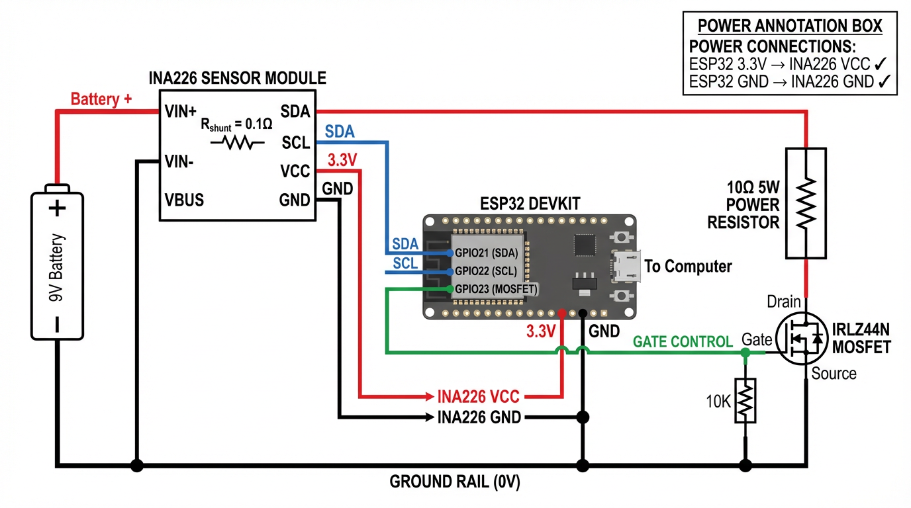

# BatTester Hardware Guide

## Schematic



## Components

| Component | Part Number | Specs | Purpose |
|-----------|-------------|-------|---------|
| ESP32 | DevKit V1 | Dual-core, WiFi, BLE | Main controller |
| INA226 | Module with shunt | 0.1Ω shunt, I2C | Voltage/current sensing |
| MOSFET | IRLZ44N | Logic-level, TO-220 | Load switching |
| Load Resistor | Ceramic | 10Ω, 5W minimum | Discharge load |
| Gate Resistor | 1/4W | 10KΩ | MOSFET pull-down |
| Filter Cap | Electrolytic | 100µF, 16V+ | Input filtering |

## Wiring Connections

### ESP32 to INA226 (I2C)

| ESP32 Pin | INA226 Pin | Wire Color |
|-----------|------------|------------|
| GPIO21 | SDA | Blue |
| GPIO22 | SCL | Blue |
| 3.3V | VCC | Red |
| GND | GND | Black |

### ESP32 to MOSFET (Load Control)

| ESP32 Pin | Connection | Notes |
|-----------|------------|-------|
| GPIO23 | Gate via 10K | Green wire, controls load |
| GND | Source | Common ground |

### Power Path

```
Battery (+) → INA226 VIN+ → [0.1Ω Shunt] → INA226 VIN- → 10Ω Load → MOSFET Drain
MOSFET Source → GND
Battery (-) → GND
```

## INA226 Configuration

- **I2C Address**: 0x40 (default, A0/A1 to GND)
- **Shunt Resistor**: 0.1Ω (on module)
- **Max Current**: ~3.2A (with 0.1Ω shunt)
- **Bus Voltage Range**: 0-36V

## Safety Notes

1. **Heat dissipation**: The 10Ω load resistor will dissipate up to 8W during 9V tests. Use a 5W+ ceramic resistor with adequate ventilation.

2. **Voltage limit**: The firmware disables load testing above 10V to prevent excessive current (>1A through 10Ω).

3. **Polarity protection**: Consider adding a diode in series for reverse polarity protection.

4. **MOSFET selection**: IRLZ44N is logic-level (fully on at 3.3V gate). Standard MOSFETs may not fully turn on.

## Calibration

1. Connect a known voltage source (e.g., bench supply at 5.00V)
2. Compare INA226 reading to multimeter
3. Adjust calibration register if needed (see firmware `ina226.cpp`)
